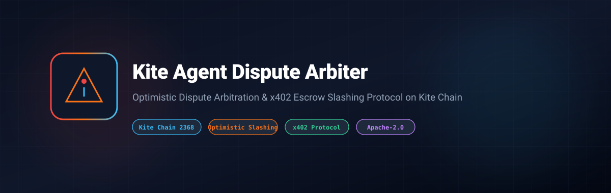

# Kite Agent Dispute Arbiter Protocol



[](LICENSE)
[](https://www.typescriptlang.org/)
[-0284c7)](https://gokite.ai)
[](https://gokite.ai)

> **Optimistic dispute arbitration and collateral slashing protocol for autonomous multi-agent task markets on Kite Chain.**

---

## 🌟 Overview

Autonomous multi-agent ecosystems executing economic actions over x402 micropayments require decentralized guarantees against malicious reasoning hallucinations, incomplete data delivery, or failure to fulfill task deliverables.

**`kite-agent-dispute-arbiter`** provides:
- **Optimistic Challenge Window**: Allows network participants to stake collateral and initiate challenges against contested agent execution digests.
- **x402 Receipt Hash Anchoring**: Locks the disputed micro-transaction hash (`x402ReceiptHash`) alongside the on-chain dispute ID.
- **Slashing & Payout Mechanism**: Slashes faulty agent collateral and automatically rewards honest challengers upon verification.

---

## 📜 Smart Contract Interface

Deployed on Kite Testnet (EIP-155: `2368`):

```solidity
function initiateDispute(
    bytes32 taskDigest,
    address agent,
    bytes32 x402ReceiptHash,
    uint256 challengeDuration
) external payable returns (bytes32 disputeId);

function resolveDispute(
    bytes32 disputeId,
    bool upholdChallenge
) external;
```

---

## 🚀 Quick Start

```bash
npm install
npm run test
npm run build
```

---

## 📄 License

Licensed under the Apache License, Version 2.0. See [LICENSE](LICENSE) for details.
